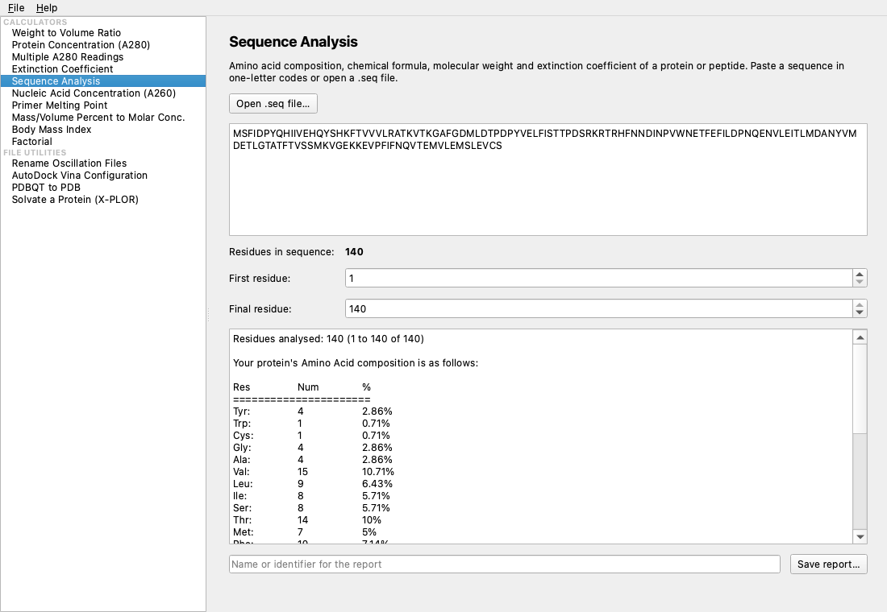

<p align="center">
  
</p>

<h1 align="center">ProtMate</h1>

<p align="center">
  <b>A system for performing biochemical &amp; biophysical calculations</b><br>
  Version 1.2.0 &middot; macOS &middot; Windows &middot; Linux
</p>

<p align="center">
  <a href="LICENSE"></a>
  <a href="https://github.com/swijeyes/ProtMate/releases"></a>
</p>

ProtMate performs common laboratory calculations, focusing on biochemical and biophysical
workflows: protein and nucleic acid concentrations, protein sequence analysis, primer melting
temperatures, solution preparation, and small utilities for crystallography and docking.

It comes in two forms that share one calculation library, so they always give identical results
and write identical report files:

- **ProtMate**, a desktop application (Qt 6) in which results update as you type;
- **pmate**, a terminal program with the classic numbered menu, for servers, SSH sessions and
  keyboard users.

<p align="center">
  
</p>

## Features

| Calculators | File utilities |
|---|---|
| Weight to volume ratio (mass or volume) | Rename oscillation images for Mosflm |
| Protein concentration and yield from A280 (one or many readings, typed or imported) | Write AutoDock Vina configuration files and run Vina |
| Extinction coefficient from residue counts | Convert PDBQT files to PDB |
| Protein sequence analysis: composition, formula, molecular weight, extinction coefficient | Generate X-PLOR/CNS scripts to solvate a protein |
| Nucleic acid concentration from A260 (dsDNA, RNA, oligonucleotides) | Open structures in RasMol |
| Primer/oligonucleotide melting temperature (basic and salt-adjusted) | |
| Mass/volume or volume percent to molar concentration | |
| Body mass index, factorial | |

## Download

Ready-to-run versions are attached to each release on the
[**Releases**](https://github.com/swijeyes/ProtMate/releases) page:

| Platform | File | Notes |
|---|---|---|
| macOS (Apple silicon, macOS 27 or later) | `ProtMate-1.2.0.dmg` | Open it and drag ProtMate to Applications. The app is not notarised: the first time, allow it in **System Settings → Privacy & Security → Open Anyway**. |
| macOS terminal version | `pmate` | Copy it to a folder on your `PATH` and run `chmod +x pmate`. |
| Windows 10/11 (x64) | `ProtMate-1.2.0-win64-portable.zip` | Extract it and run `ProtMate.exe` or `pmate.exe`; nothing to install. SmartScreen may ask you to confirm (**More info → Run anyway**). |
| Linux, other Macs | Source code | Build it as described below. |

The [**user guide**](docs/ProtMate_User_Guide.pdf) explains installation on each platform and
every calculator and menu option in detail.

## Building from source

You need CMake 3.21 or later, a C++17 compiler and, for the desktop application, Qt 6.5 or later.

```sh
git clone https://github.com/swijeyes/ProtMate.git
cd ProtMate

# macOS:          brew install cmake qt
# Debian/Ubuntu:  sudo apt install build-essential cmake qt6-base-dev
# Fedora:         sudo dnf install gcc-c++ cmake qt6-qtbase-devel
# Arch:           sudo pacman -S --needed base-devel cmake qt6-base

cmake -S . -B build          # on macOS add -DCMAKE_PREFIX_PATH="$(brew --prefix qt)"
cmake --build build -j
ctest --test-dir build       # runs the core unit tests
sudo cmake --install build   # optional: installs ProtMate and pmate into /usr/local/bin
```

Build options:

| Option | Effect |
|---|---|
| `-DPMATE_BUILD_GUI=OFF` | Terminal version only; Qt is not needed. Use this on systems whose Qt is older than 6.5 (for example Ubuntu 24.04). |
| `-DPMATE_BUILD_TESTS=OFF` | Skip the unit tests. |
| `-DPMATE_SANITIZE=ON` | Build with AddressSanitizer and UndefinedBehaviorSanitizer. |

## Using ProtMate

**Desktop application:** choose a tool from the list on the left and fill in the form. Results
update as you type, and **Save report…** writes the same report file the terminal version writes.

**Terminal version:** run `pmate`, type `mnu` to show the main menu, then type a menu number (for
example `3`) or a command name (for example `prot`). Type `?` for all commands and `0` to quit.

```text
alice% > 3

Enter total volume of protein (in ml): 2.5
Enter A280 of protein: 0.42
Enter total volume of liquid in cuvette (protien + buffer) (in ul): 100
Enter volume of protein in cuvette (ul): 10
Enter protein's extinction coefficient: 0.92

Dilution factor: 10

Protein concentration: 4.57 mg/ml
Total amount of protein present in 2.5 ml: 11.425 mg
```

AutoDock Vina and RasMol are optional. ProtMate finds them on your `PATH` and starts them directly,
never through a shell.

## Repository layout

| Path | Contents |
|---|---|
| `core/` | `pmate_core.{h,cpp}`: every calculation, report format and validation helper. Standard C++17 only, with no I/O and no platform calls. |
| `cli/pmate_cli.cpp` | The terminal version (POSIX and Windows). |
| `gui/` | The Qt 6 Widgets desktop application: `MainWindow` and one page per tool in `gui/pages/`. |
| `resources/` | Application icons: `ProtMate.icns` (macOS), `ProtMate.ico` (Windows) and `pmate_icon.png`. |
| `tests/core_tests.cpp` | Unit tests for the core library (run by `ctest`). |
| `docs/` | The user guide: LaTeX source, screenshots and the compiled PDF. |
| `SECURITY_CHANGES.md` | Security fixes made in version 1.1.6. |
| `LICENSE` | The GNU General Public License, version 3. |

## Packaging notes

<details>
<summary>How the release files are made</summary>

- **macOS app:** `macdeployqt build/ProtMate.app`, then delete
  `PlugIns/iconengines/libqsvgicon.dylib` and `PlugIns/imageformats/libqpdf.dylib` (with Homebrew's
  Qt their QtSvg/QtPdf dependencies aren't bundled, and ProtMate doesn't use them), and re-sign with
  `codesign --force --deep -s - build/ProtMate.app` (use a Developer ID instead of `-` to sign for
  distribution). A build made against Homebrew's Qt runs only on the macOS version it was built on
  or later, because Homebrew's libraries are built for the host system.
- **macOS disk image:** put the finished app and a link to `/Applications` in an empty folder, then
  `hdiutil create -volname "ProtMate 1.2.0" -srcfolder <folder> -format UDZO -o ProtMate-1.2.0.dmg`.
- **Windows (native):** `windeployqt build\Release\ProtMate.exe`, then zip the folder.
- **Windows, cross-compiled on macOS.** Qt's MinGW build uses the old msvcrt C runtime and
  Homebrew's `mingw-w64` uses UCRT, so they can't be mixed. Use Qt's **llvm-mingw** build with the
  matching toolchain instead:
  1. Download the macOS toolchain `llvm-mingw-20231128-ucrt-macos-universal` (LLVM 17.0.6, the
     version Qt 6.11.2 was built with) from https://github.com/mstorsjo/llvm-mingw/releases.
  2. Extract the `qtbase` package from
     `download.qt.io/online/qtsdkrepository/windows_x86/desktop/qt6_6112/qt6_6112_llvm_mingw/qt.qt6.6112.win64_llvm_mingw/`.
     Its version must match the host Qt (Homebrew's), which supplies `moc`, `rcc` and `uic`.
  3. Write a CMake toolchain file that sets `CMAKE_SYSTEM_NAME Windows`, the compilers to
     `x86_64-w64-mingw32-clang`/`clang++` and `CMAKE_RC_COMPILER` to `x86_64-w64-mingw32-windres`,
     then configure with `-DCMAKE_PREFIX_PATH=<windows qt> -DQT_HOST_PATH=$(brew --prefix qtbase)
     -DQT_HOST_PATH_CMAKE_DIR=$(brew --prefix qtbase)/lib/cmake`.
  4. Copy next to `ProtMate.exe`: `Qt6Core.dll`, `Qt6Gui.dll`, `Qt6Widgets.dll`,
     `platforms/qwindows.dll`, `styles/qmodernwindowsstyle.dll`, and the toolchain's `libc++.dll` and
     `libunwind.dll`, plus `LICENSE` and the Qt and LLVM licence texts. `pmate.exe` is linked
     statically and needs none of the DLLs.
- **Linux:** `cmake --install build --prefix /usr/local`, or package as an AppImage with
  `linuxdeploy --plugin qt`.
- **Icons:** the files in `resources/` were generated from a single 835 px PNG with `sips`,
  `iconutil` (macOS `.icns`) and a PNG-in-ICO writer (Windows `.ico`). Regenerate all three if the
  artwork changes.

</details>

## Reporting problems

Please report bugs and incorrect results on the
[issue tracker](https://github.com/swijeyes/ProtMate/issues). Include the ProtMate version (shown by
**Help → About ProtMate**, or `abt` in the terminal version), your operating system, the values you
entered and the result you expected. Pull requests are welcome.

## License

Copyright © 2024–2026 Sanjeeva Wijeyesakere

ProtMate is free software: you can redistribute it and/or modify it under the terms of the GNU
General Public License as published by the Free Software Foundation, version 3. See
[LICENSE](LICENSE) for the full text.

The desktop application uses [Qt](https://www.qt.io) under the GNU LGPL version 3. The Windows
package also includes the `libc++` and `libunwind` runtime libraries from the LLVM project (Apache
License 2.0 with LLVM Exceptions).

## Disclaimer

ProtMate is distributed in the hope that it will be useful, but **without any warranty**; without
even the implied warranty of merchantability or fitness for a particular purpose. **The author
assumes no liability for the accuracy of calculations** or for the functionality of the program.
Always verify results independently before relying on them. The body mass index calculator is
included for convenience only and is not medical advice.
